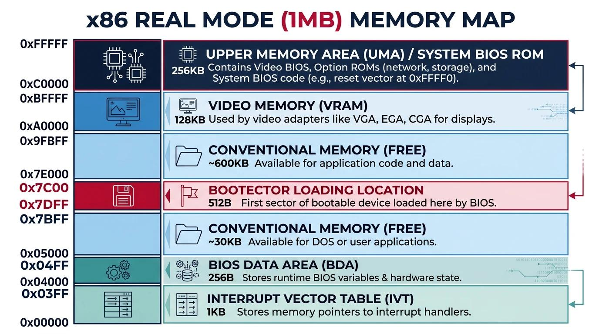

# 1.3.1 Hello World 启动扇区

```nasm
BOOTSEG=0x7c0

.code16
.text

.global _start
_start:
  jmpl $BOOTSEG,$start2

start2:
  movw $BOOTSEG,%ax
  movw %ax,%ds
  movw %ax,%es
  movw %ax,%fs
  movw %ax,%gs

  movw $msg,%ax
  movw %ax,%bp
  movw $0x01301,%ax
  movw $0x0c,%bx  #文字为红色
  movw $12,%cx    #字符串长度
  movb $0,%dl     # dh表示行号  dl表示列号
  int $0x010    #通知显卡刷新内容

loop:
  jmp loop

msg:
.ascii "Hello World!"

.org 510
boot_flag:
  .word 0xaa55

```

这是一段 x86 汇编代码（GNU Assembler，简称 GAS），目标是编写一个传统 BIOS 启动扇区（Boot Sector）。它运行在计算机刚启动时，由 BIOS 加载到内存中执行。

代码的目标很简单：在屏幕上显示红色的 `Hello World!`，然后进入死循环。 这也是学习操作系统内核时常见的入门实验。

## 1 这段代码是怎么工作的？



传统 BIOS 启动时，会将启动扇区加载到物理内存地址 `0x7C00`，然后跳转到那里执行代码。

你的代码分成几个部分：

### 1.1 定义启动段和代码模式

```
BOOTSEG = 0x7c0

.code16
.text

.global _start
```

- `BOOTSEG = 0x7c0`：定义一个常量，表示段地址。
    
- `.code16`：告诉汇编器生成 16 位 x86 指令。
    
- `.text`：表示代码段。
    
- `.global _start`：将 `_start` 符号导出，使链接器能够识别它。
    


### 1.2 跳转到指定代码段

```
_start:
    jmpl $BOOTSEG, $start2
```

这里定义了入口标签 `_start`，随后执行远跳转（Far Jump）。

远跳转可以同时修改：

- `CS`：代码段寄存器。
    
- `IP`：指令指针。
    

这里的 `$BOOTSEG` 和 `$start2` 是 GNU 汇编器的 AT&T 语法写法。

不过，这段代码存在一个需要注意的地方：BIOS 通常将启动扇区加载到物理地址 `0x7C00`，但 `CS:IP` 的初始值可能有不同形式。因此，远跳转通常用于统一代码段和指令地址的解释方式。

### 1.3 初始化数据段寄存器

```
start2:
    movw $BOOTSEG, %ax
    movw %ax, %ds
    movw %ax, %es
    movw %ax, %fs
    movw %ax, %gs
```

这里把 `0x07C0` 写入 `DS`、`ES`、`FS`、`GS`。

|寄存器|作用|
|---|---|
|`AX`|通用寄存器，临时保存段地址|
|`DS`|默认数据段|
|`ES`|附加数据段|
|`FS`|附加段寄存器|
|`GS`|附加段寄存器|

在 16 位实模式下，物理地址通常按下面的公式计算：

\[ \text{物理地址}=\text{段地址}\times16+\text{偏移地址} \]

所以：

\[ 0x07C0\times16=0x7C00 \]

也就是说，`DS = 0x07C0` 时，偏移地址为 `0` 对应物理地址 `0x7C00`。

### 1.4 设置字符串和显示参数

```
    movw $msg, %ax
    movw %ax, %bp
    movw $0x1301, %ax
    movw $0x0c, %bx
    movw $12, %cx
    movb $0, %dl
    int $0x10
```

这里调用的是 BIOS 视频服务中断 `INT 10h`。

- `msg`：字符串的起始位置。
    
- `BP`：保存字符串偏移地址。
    
- `AX = 0x1301`：选择 BIOS 的字符串输出功能及相关模式。
    
- `BX = 0x000C`：设置页面号和字符属性，其中 `0x0C` 表示红色前景色（亮红色）。
    
- `CX = 12`：指定输出 12 个字符。
    
- `DL = 0`：设置 `DX` 的低字节，但在这个调用中并不是字符串输出的关键参数。
    
- `INT 10h`：调用 BIOS 视频服务。
    

字符串定义如下：

```
msg:
    .ascii "Hello World!"
```

`Hello World!` 恰好有 12 个字符。

这里有一个重要细节： `BP` 默认通过 `SS` 段访问，而不是 `DS`。BIOS 的 `INT 10h / AH=13h` 字符串输出服务使用 `ES:BP` 指向字符串。因此，如果 `ES` 已设置为 `0x07C0`，就能正确读取 `msg`。这也是前面初始化 `ES` 的原因。

### 1.5 进入死循环

```
loop:
    jmp loop
```

程序跳转回自身，永远循环下去。

这是最简单的停止方式之一：避免执行完显示代码后继续运行未知内存中的指令。

### 1.6 填充启动扇区

```
.org 510
boot_flag:
    .word 0xaa55
```

传统 BIOS 启动扇区的大小为 512 字节。

- `.org 510`：将当前位置推进到当前段偏移 510。
    
- `.word 0xaa55`：写入 16 位数值 `0xAA55`。
    

在 x86 的小端字节序下，最后两个字节会是：

```
55 AA
```

BIOS 通常通过启动扇区末尾的 `55 AA` 标志判断该扇区是否具有有效的启动签名。
可以这样查看
```BASH
❯ od -An -tx1 -j510 -N2 linux.img
 55 aa
```


## 2 汇编
```BASH
as --32 -o bootsect.o bootsect.S
```

## 3 链接并生成原始二进制文件
```BASH
ld -m elf_i386 -Ttext 0x0  --oformat binary  -o linux.img bootsect.o
```


```BASH
tingle in Linux-Kernel-from-Scratch-Reading-Notes/1.3.1_hellowold on  main
❯ ls -la
total 40
drwxr-xr-x 2 tingle tingle    4096 Oct 19 14:58 .
drwxr-xr-x 4 tingle tingle    4096 Oct 19 14:58 ..
-rw-r--r-- 1 tingle tingle     429 Oct 19 14:58 bootsect.S
-rw-r--r-- 1 tingle tingle    1120 Oct 19 14:58 bootsect.o
-rw-r--r-- 1 tingle tingle 1474560 Oct 19 14:58 floppy.img
-rwxr-xr-x 1 tingle tingle     512 Oct 19 14:58 linux.img
```

## 4 用 QEMU 启动
```BASH
# 创建 1.44 MB 的空白软盘镜像
dd if=/dev/zero of=floppy.img bs=512 count=2880

# 把启动扇区写入软盘的第一个扇区
dd if=bootsect.bin of=floppy.img conv=notrunc

# 启动 QEMU，指定从软盘启动
qemu-system-i386 \
  -drive file=floppy.img,format=raw,if=floppy \
  -boot order=a
```


## 5 解析镜像

```BASH
❯ od -An -tx1   linux.img
 66 ea 08 00 00 00 c0 07 b8 c0 07 8e d8 8e c0 8e
 e0 8e e8 b8 27 00 89 c5 b8 01 13 bb 0c 00 b9 0c
 00 b2 00 cd 10 eb fe 48 65 6c 6c 6f 20 57 6f 72
 6c 64 21 00 00 00 00 00 00 00 00 00 00 00 00 00
 00 00 00 00 00 00 00 00 00 00 00 00 00 00 00 00
*
 00 00 00 00 00 00 00 00 00 00 00 00 00 00 55 aa
```

|   |   |   |   |   |
|---|---|---|---|---|
|address|00 01 02 03 04 05 06 07|08 09 10 11 12 13 14 15||AscII  UTF8  UTF16  int8  int16  int32  int64  float32  float64|
|00000000|66 ea 08 00 00 00 c0 07|b8 c0 07 8e d8 8e c0 8e||f...............|
|00000010|e0 8e e8 b8 27 00 89 c5|b8 01 13 bb 0c 00 b9 0c||....'...........|
|00000020|00 b2 00 cd 10 eb fe 48|65 6c 6c 6f 20 57 6f 72||.......Hello Wor|
|00000030|6c 64 21 00 00 00 00 00|00 00 00 00 00 00 00 00||ld!.............|
|00000040|00 00 00 00 00 00 00 00|00 00 00 00 00 00 00 00||................|
|00000050|00 00 00 00 00 00 00 00|00 00 00 00 00 00 00 00||................|
|00000060|00 00 00 00 00 00 00 00|00 00 00 00 00 00 00 00||................|
|00000070|00 00 00 00 00 00 00 00|00 00 00 00 00 00 00 00||................|
|00000080|00 00 00 00 00 00 00 00|00 00 00 00 00 00 00 00||................|
|00000090|00 00 00 00 00 00 00 00|00 00 00 00 00 00 00 00||................|
|000000a0|00 00 00 00 00 00 00 00|00 00 00 00 00 00 00 00||................|
|000000b0|00 00 00 00 00 00 00 00|00 00 00 00 00 00 00 00||................|
|000000c0|00 00 00 00 00 00 00 00|00 00 00 00 00 00 00 00||................|
|000000d0|00 00 00 00 00 00 00 00|00 00 00 00 00 00 00 00||................|
|000000e0|00 00 00 00 00 00 00 00|00 00 00 00 00 00 00 00||................|
|000000f0|00 00 00 00 00 00 00 00|00 00 00 00 00 00 00 00||................|
|00000100|00 00 00 00 00 00 00 00|00 00 00 00 00 00 00 00||................|
|00000110|00 00 00 00 00 00 00 00|00 00 00 00 00 00 00 00||................|
|00000120|00 00 00 00 00 00 00 00|00 00 00 00 00 00 00 00||................|
|00000130|00 00 00 00 00 00 00 00|00 00 00 00 00 00 00 00||................|
|00000140|00 00 00 00 00 00 00 00|00 00 00 00 00 00 00 00||................|
|00000150|00 00 00 00 00 00 00 00|00 00 00 00 00 00 00 00||................|
|00000160|00 00 00 00 00 00 00 00|00 00 00 00 00 00 00 00||................|
|00000170|00 00 00 00 00 00 00 00|00 00 00 00 00 00 00 00||................|
|00000180|00 00 00 00 00 00 00 00|00 00 00 00 00 00 00 00||................|
|00000190|00 00 00 00 00 00 00 00|00 00 00 00 00 00 00 00||................|
|000001a0|00 00 00 00 00 00 00 00|00 00 00 00 00 00 00 00||................|
|000001b0|00 00 00 00 00 00 00 00|00 00 00 00 00 00 00 00||................|
|000001c0|00 00 00 00 00 00 00 00|00 00 00 00 00 00 00 00||................|
|000001d0|00 00 00 00 00 00 00 00|00 00 00 00 00 00 00 00||................|
|000001e0|00 00 00 00 00 00 00 00|00 00 00 00 00 00 00 00||................|
|000001f0|00 00 00 00 00 00 00 00|00 00 00 00 00 00 55 aa||..............U.|

|字节偏移|内容|说明|
|---|---|---|
|`0–39`|启动代码|CPU 执行的机器指令|
|`40–51`|`Hello World!`|要显示的字符串，共 12 字节|
|`52–509`|`00` 填充|补齐启动扇区的剩余空间|
|`510–511`|`55 aa`|BIOS 启动签名|

### 5.1 为什么后面都是 0？

因为你的汇编代码里有：

```
.ascii "Hello World!"

.org 510
.word 0xaa55
```

`.ascii` 写入字符串，`.org 510` 将后续输出位置调整到偏移 510。中间没有被其他指令或数据占用的空间，在这种汇编输出场景下会填充为零。

可以理解为：你只写了大约 52 字节的代码和数据，但 BIOS 启动扇区需要 512 字节，因此剩余空间被填充。