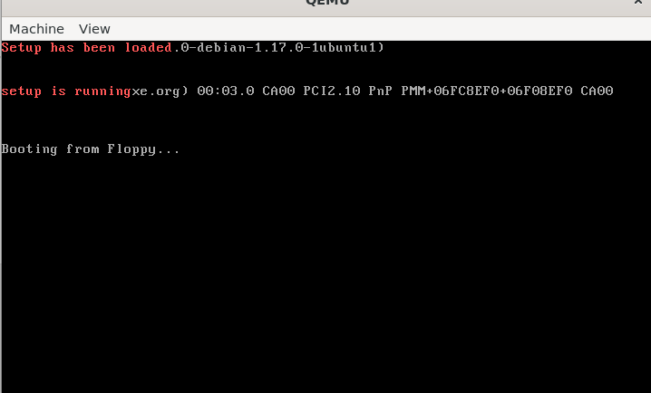

# 2.1.1 Setup 模块

本章节演示一个早期 Linux 启动流程中的 setup 模块：

1. BIOS 将 `bootsect` 加载到物理地址 `0x7C00`；
2. `bootsect.S` 将自身复制到 `0x90000`；
3. `bootsect.S` 通过 BIOS `INT 13h` 将 setup 模块加载到 `0x90200`；
4. `bootsect.S` 跳转到 setup 模块；
5. `setup.S` 通过 BIOS `INT 10h` 在屏幕上显示提示信息。

## 目录结构

```text
2.1.1-setup-module/
├── Makefile
├── bootsect.S
├── setup.S
├── bootsect_readme.md
└── README.md
```

镜像构建工具位于项目根目录：

```text
../tools/build.c
```

## 构建环境

需要安装：

- GNU assembler（`as`）
- GNU linker（`ld`）
- GCC
- GNU Make
- QEMU x86 模拟器

项目通用的环境安装说明位于项目根目录的 [`README.md`](../README.md)。

## 使用 Makefile

进入本章节目录：

```bash
cd 2.1.1-setup-module
```

查看 Makefile 即将执行的命令，不实际执行：

```bash
make -n
```

构建 setup 模块：

```bash
make setup
```

构建位于项目根目录的镜像构建工具：

```bash
make ../tools/build
```

清理本章节生成的目标文件和镜像：

```bash
make clean
```

## 当前完整构建流程的说明

Makefile 中的 `linux.img` 目标对应完整的早期 Linux 启动镜像流程，需要以下三个输入文件：

```text
bootsect setup system
```

其中当前章节已经提供：

- `bootsect.S`
- `setup.S`

但 `system` 内核部分属于后续内容，目前还没有加入本章节。因此，直接执行：

```bash
make
```

可能会因为缺少 `system` 文件，或者 `bootsect.S` 中的 `ROOT_DEV` 尚未由完整构建流程提供，而无法生成最终镜像。这不是 QEMU 命令的问题，而是当前章节代码还处于启动流程拆分学习阶段。

## 使用 QEMU 启动镜像

当前 Makefile 的目标文件名是：

```text
linux.img
```

因此启动时应使用：

```bash
qemu-system-i386 \
  -drive file=linux.img,format=raw,if=floppy \
  -boot order=a
```

如果镜像文件被命名为 `floppy.img`，那么用户给出的命令也是正确的：

```bash
qemu-system-i386 \
  -drive file=floppy.img,format=raw,if=floppy \
  -boot order=a
```

关键是 `file=` 后面的文件名必须和实际生成的镜像文件一致。

如果当前位于项目根目录，也可以直接使用章节目录下的相对路径启动：

```bash
qemu-system-i386 \
  -drive file=2.1.1-setup-module/linux.img,format=raw,if=floppy \
  -boot order=a
```

## 预期现象

如果启动镜像内容完整，屏幕上应该依次看到类似提示：

```text
Setup has been loaded
setup is running
```

本次运行结果：



从截图中可以看到，启动扇区已经成功加载 setup 模块，并且 setup 模块也成功调用 BIOS 视频服务显示了提示信息：

- `Setup has been loaded`：由 `bootsect.S` 在读取 setup 成功后显示；
- `setup is running`：由 `setup.S` 启动后显示。

当前 `setup.S` 在显示字符串后还没有加入 `halt`、死循环或下一阶段跳转。因此，显示完成后 CPU 可能继续把后面的数据当作指令执行，出现停顿、异常或重启。这是当前实验代码尚未完成后续流程的表现。

## 代码详解

- [`bootsect.S`](./bootsect.S)：启动扇区代码，负责搬移自身、读取 setup 并跳转。
- [`setup.S`](./setup.S)：setup 模块入口，通过 BIOS 视频服务显示提示信息。
- [`bootsect_readme.md`](./bootsect_readme.md)：`bootsect.S` 的逐段阅读笔记。
